# 🛡️ SafeStep — Smart Elderly Safety & Care Application

<p align="center">
  
  
  
  
  
  
  
  
  
</p>

> **An intelligent, elder-centric mobile application designed to provide instantaneous emergency assistance, medication adherence tracking, health record management, and live safety monitoring.**

SafeStep is a collaborative final-year Diploma in Computer Engineering capstone project from **K. J. Somaiya Polytechnic**, bridging an accessible mobile application with a wearable IoT fall-detection system. 

This repository documents the **software architecture, mobile application, cloud services, and integration layer** created and maintained by **Sonal Shailesh Parmar**.

---

## 📑 Table of Contents

- [Executive Overview](#-executive-overview)
- [System Architecture](#-system-architecture)
- [Core Features](#-core-features)
- [📸 Application Screenshots](#-application-screenshots)
  - [Authentication Flow](#1-authentication-flow)
  - [Dashboard & AI Health Insights](#2-dashboard--ai-health-insights)
  - [Medication Management](#3-medication-management)
  - [Medical History & Health Passport](#4-medical-history--health-passport)
  - [Emergency SOS & Alerts](#5-emergency-sos--alerts)
  - [Safety Navigation & Live Tracking](#6-safety-navigation--live-tracking)
  - [Wearable Hardware & IoT Integration](#7-wearable-hardware--iot-integration)
- [Project Structure](#-project-structure)
- [Technology Stack](#-technology-stack)
- [Quality Assurance & Testing](#-quality-assurance--testing)
- [Getting Started](#-getting-started)
- [Academic Context & Author](#-academic-context--author)
- [License](#-license)

---

## 🌟 Executive Overview

| Module | Technology | Highlights |
|---|---|---|
| 📱 **Mobile Application** | Flutter & Dart | High-contrast, large-target elder-friendly UI supporting Dark & Light themes |
| 🚨 **Emergency System** | Flutter, GeoLocator, Twilio, Webhooks | One-tap emergency dispatch, primary contact calling, SMS/WhatsApp alerts |
| 💊 **Medicine Management** | Flutter, Cloud Firestore, Local Notifications | Multi-dose daily schedules, adherence score, pre-reminder & alarm alarms |
| 🏥 **Medical History** | Cloud Firestore | Categorized health records (conditions, prescriptions, allergies, blood type) |
| 🤖 **AI Health Insights** | Flutter & FL Chart | Safety scoring, reaction speed tracking, sleep duration, and adherence trends |
| 📍 **Safe Places & Tracking** | FlutterMap & OpenStreetMap | Instant detection of nearby police stations and hospitals with route guidance |
| 🌐 **Localization** | Flutter Internationalization | Trilingual accessibility: English, Hindi (हिंदी), and Marathi (मराठी) |
| 🔌 **IoT Wearable Link** | ESP32-C3, MPU6050, n8n/Make Webhooks | Instant software notification on hardware-detected physical falls |

---

## 🏗️ System Architecture

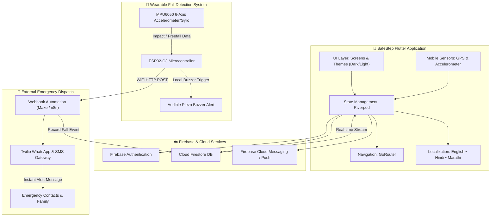

---

## ⚡ Core Features

### 🚨 One-Tap SOS & Emergency Dispatch
- Prominently positioned, accessible central emergency button designed with haptic and visual feedback.
- Immediately retrieves real-time GPS coordinates and notifies designated primary contacts.
- Logs incident metadata with timestamps and location to Cloud Firestore.

### 💊 Intelligent Medication Management
- Allows elderly users and guardians to schedule daily, weekly, or as-needed medications.
- Real-time status indicators: **Upcoming**, **Taken**, **Missed**, and **Skipped**.
- Scheduled dual notifications (a gentle pre-reminder followed by an exact-time alert).

### 🏥 Digital Medical History & Emergency Passport
- Central repository for chronic conditions (e.g., Diabetes, Hypertension), allergies, blood group, and donor status.
- Quick-access view for paramedics or emergency responders in critical scenarios.

### 🤖 AI Health Insights & Safety Analytics
- Dynamic **Safety Score** derived from daily medication compliance and movement stability.
- Visual trend curves representing response speeds, rest quality, and compliance percentages.

### 📍 Nearby Emergency Services & Safe Places
- Detects the nearest hospitals, medical clinics, and police stations using high-accuracy geolocation.
- Turn-by-turn route calculations via OSRM and one-tap launching in Google Maps.

### 🛡️ Guardian Mode & Live Location Tracking
- Generates secure, shareable live location URLs for caregivers.
- Background location updating with configurable power optimization.

### 🌐 Trilingual Accessibility
- Full native translation across the interface in **English**, **Hindi (हिंदी)**, and **Marathi (मराठी)**.

---

# 📸 Application Screenshots

### 1. Authentication Flow
Simple, high-contrast credential forms with immediate validation and clear status prompts.

| Login Screen | Create Account Screen |
|:---:|:---:|
| 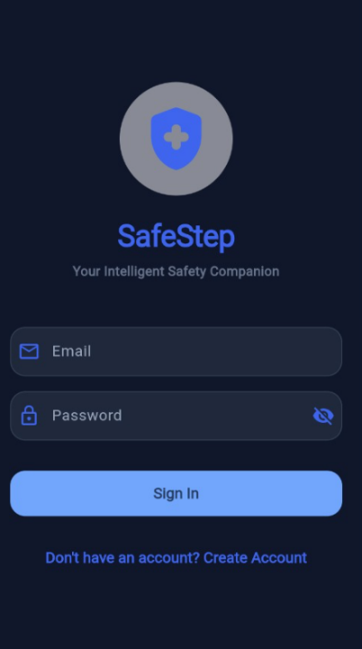 | 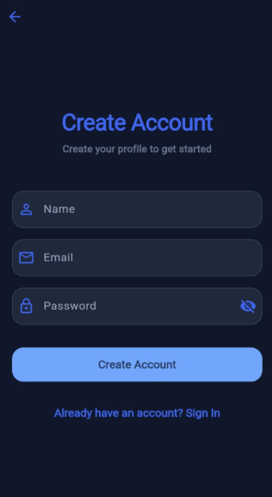 |
| *Sign in with email and password* | *Elderly profile registration* |

---

### 2. Dashboard & AI Health Insights
Centralized hub displaying safety score, quick actions, today's medication summary, and behavioral trend analysis.

| Safety Dashboard (Dark Mode) | Safety Dashboard (Light Mode) | AI Health Insights & Trends |
|:---:|:---:|:---:|
| 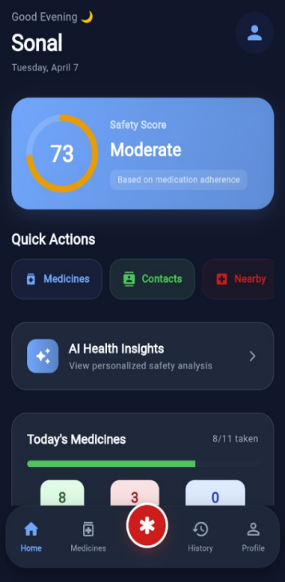 | 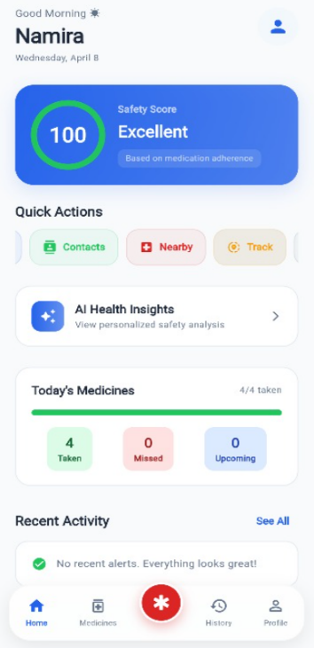 | 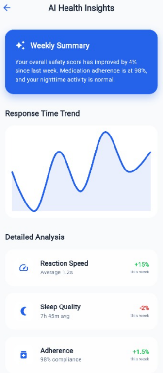 |
| *High-contrast safety score & navigation* | *Clean daylight theme with activity stats* | *Weekly summary, reaction speed, adherence* |

---

### 3. Medication Management
Interactive date selector, chronological dose cards, and single-tap intake confirmation.

| Medication Schedule (Light Mode) | Medication Schedule (Dark Mode) |
|:---:|:---:|
| 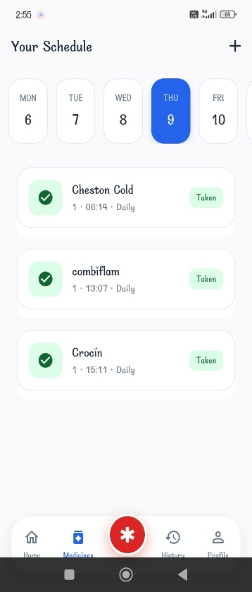 | 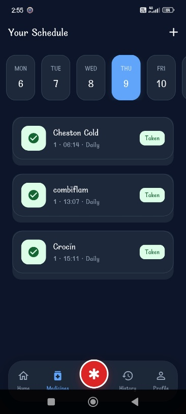 |
| *Weekly calendar ribbon & daily dose checklist* | *Night mode medication view with status tags* |

---

### 4. Medical History & Health Passport
Chronic conditions, emergency notes, active prescriptions, and critical medical alerts.

| Medical History (Light Mode) | Medical History (Dark Mode) |
|:---:|:---:|
| 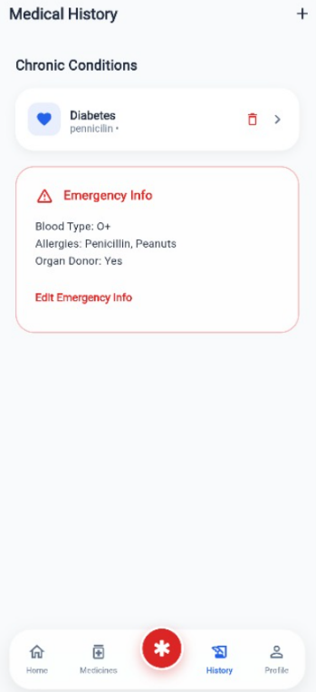 | 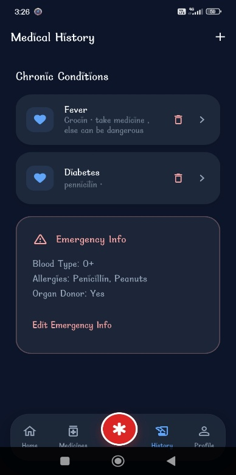 |
| *Emergency passport (Blood Group, Allergies, Donor)* | *Chronic conditions list with quick edit* |

---

### 5. Emergency SOS & Alerts
Central safety trigger with direct access to nearby hospitals, incident reporting, and primary contact dispatch.

| Emergency Help (Light Mode) | Emergency Help (Dark Mode) |
|:---:|:---:|
| 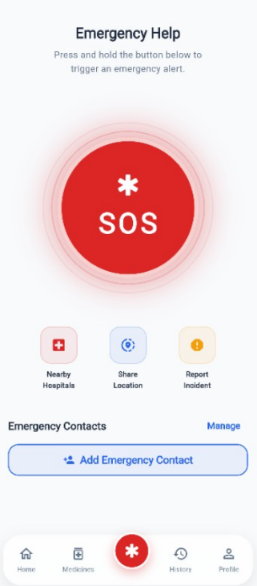 | 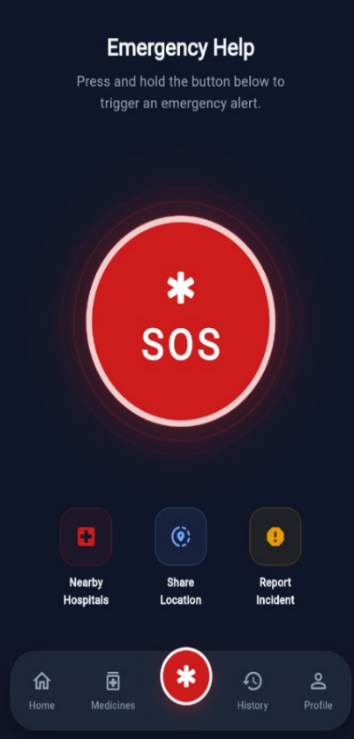 |
| *High-visibility emergency SOS button* | *Dark-mode emergency control center* |

---

### 6. Safety Navigation & Live Tracking
Proximity search for essential services and real-time GPS link sharing for family peace of mind.

| Nearby Safe Places | Guardian Mode Live Tracking |
|:---:|:---:|
| 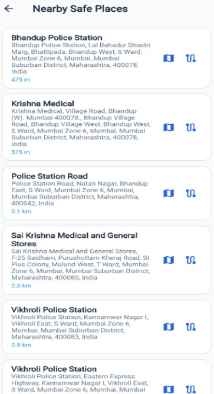 | 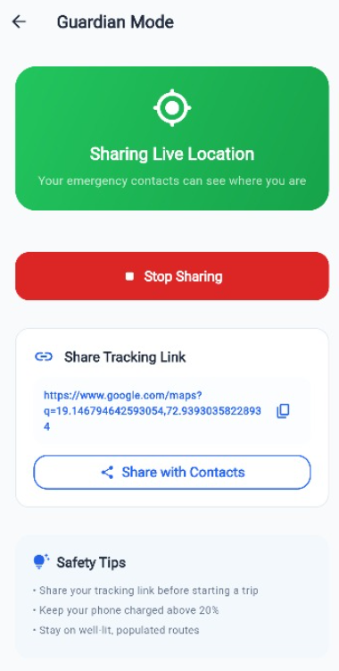 |
| *Proximity list of hospitals and police stations* | *Real-time GPS sharing link with contacts* |

---

### 7. Wearable Hardware & IoT Integration
Hardware prototype developed alongside the software, featuring automatic fall detection, buzzer alarms, and instant WhatsApp alerts.

| Hardware Circuit Wiring | Firmware Fall Logic | WhatsApp Alert Delivery |
|:---:|:---:|:---:|
| 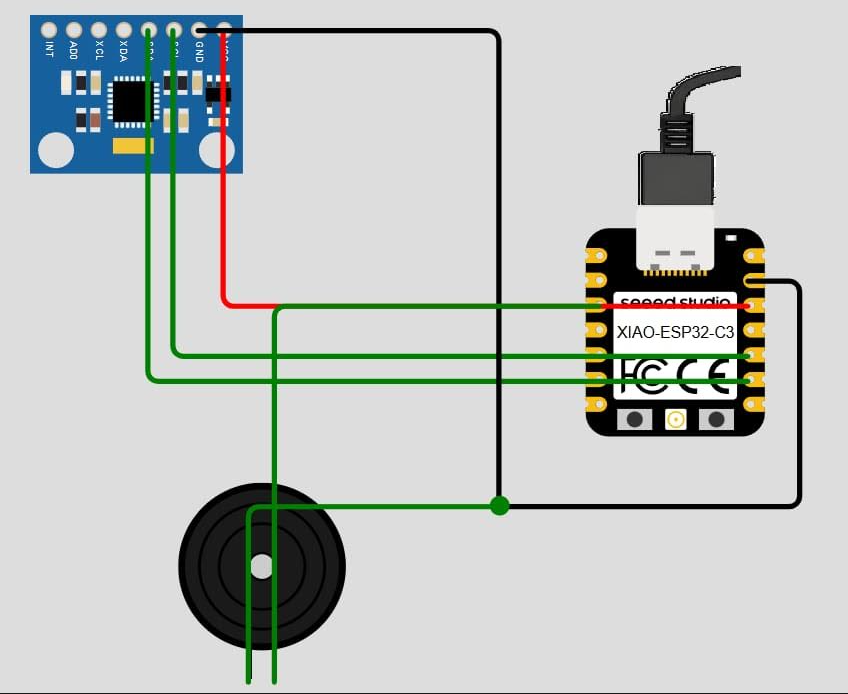 | 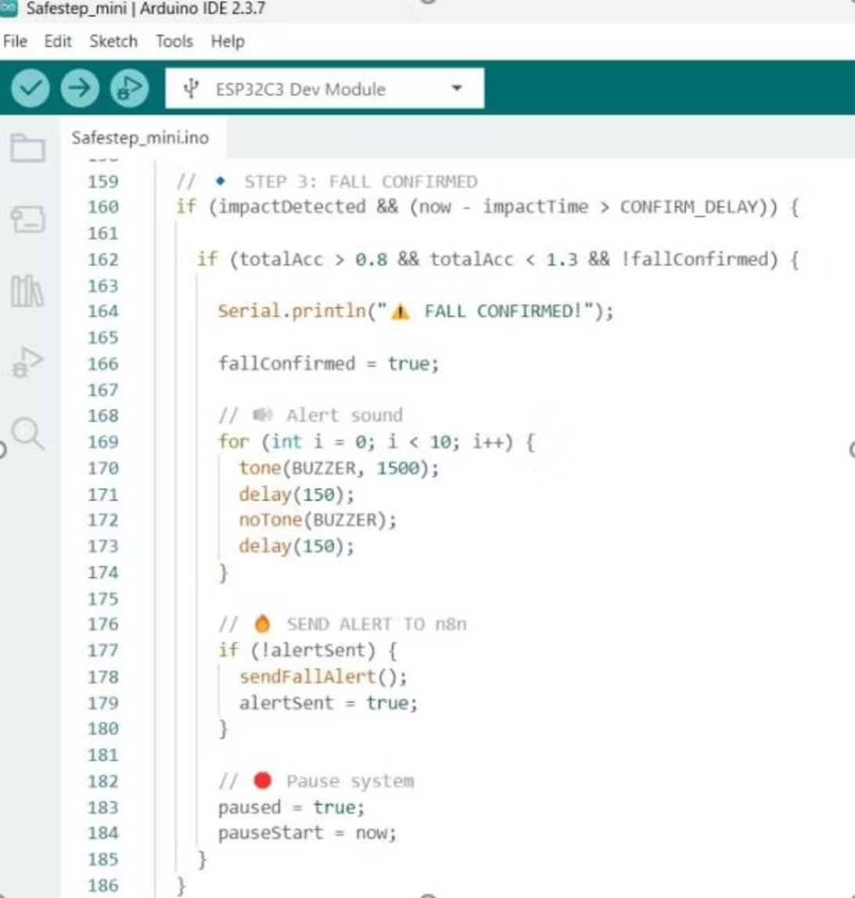 | 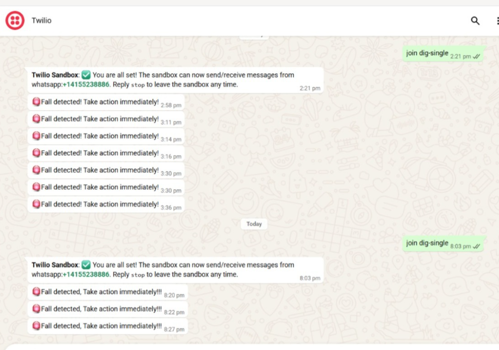 |
| *XIAO ESP32-C3 + MPU6050 + Buzzer* | *Two-stage acceleration impact detection* | *Twilio WhatsApp instant alert delivery* |

| System Automation Webhook | Fall Detection Decision Flowchart |
|:---:|:---:|
| 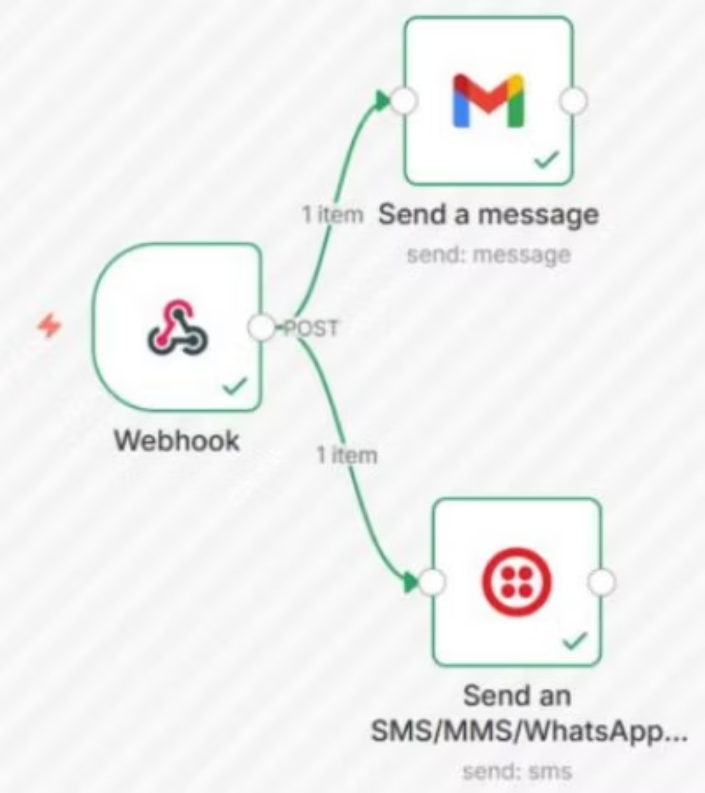 | 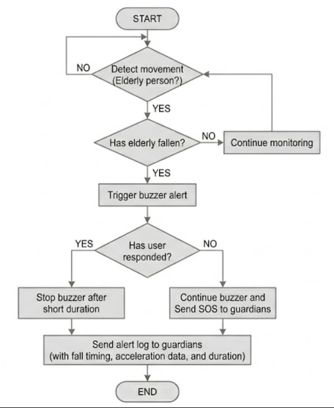 |
| *HTTP Webhook dispatch to Gmail & Twilio* | *End-to-end event and buzzer resolution logic* |

---

## 📂 Project Structure

```text
SafeStepApp/
├── .github/
│   └── workflows/
│       ├── flutter_ci.yml          # Automated CI: analysis & test execution
│       └── static.yml              # GitHub Pages deployment workflow
├── android/                        # Android native configurations & manifests
├── assets/
│   ├── fonts/                      # MaterialIcons typography
│   └── images/                     # Graphic resources and icons
├── docs/
│   └── screenshots/                # 18 high-resolution UI and system captures
├── ios/                            # iOS native configurations
├── macos/                          # macOS native configurations
├── web/                            # Web engine bootstrap and manifest
├── lib/
│   ├── core/
│   │   ├── constants/              # AppColors, AppStrings
│   │   ├── l10n/                   # Manual trilingual dictionary (EN, HI, MR)
│   │   ├── theme/                  # High-contrast Light and Dark AppThemes
│   │   └── utils/                  # DateTimeUtils, SnackbarUtils, UiUtils
│   ├── features/
│   │   ├── auth/screens/           # Login & Registration screens
│   │   ├── contacts/screens/       # Contact listing & Form screens
│   │   ├── dashboard/screens/      # Main Dashboard, Shell, AI Health Insights
│   │   ├── history/screens/        # Medical History timeline & Forms
│   │   ├── medicines/screens/      # Medicine schedules & Form management
│   │   ├── profile/screens/        # Profile overview & Edit screen
│   │   └── safety/screens/         # Nearby Places, Live Tracking, Incident Reports
│   ├── models/                     # Medication, Contact, History, SosAlert, Profile
│   ├── providers/                  # Riverpod auth, data, shell, and locale providers
│   ├── routes/                     # GoRouter central navigation definitions
│   ├── services/                   # Firebase, Notifications, Location, SOS, OSRM
│   ├── firebase_options.dart       # Default Firebase configuration
│   └── main.dart                   # Application entry point
├── test/
│   ├── models_test.dart            # Unit tests for data models & serialization
│   ├── utils_test.dart             # Unit tests for dates, theme, and l10n
│   └── widget_test.dart            # Smoke and structure widget tests
├── analysis_options.yaml           # Lint and static analysis configuration
├── pubspec.yaml                    # Dependencies and package specifications
├── FIREBASE_SETUP.md               # Backend Firebase setup guide
├── LICENSE                         # MIT License
└── README.md                       # Comprehensive project documentation
```

---

## 🛠️ Technology Stack

| Domain | Technology / Package | Purpose |
|---|---|---|
| **Framework** | [Flutter](https://flutter.dev/) (v3.44+) | Cross-platform UI development for mobile and web |
| **Language** | [Dart](https://dart.dev/) (v3.12+) | Type-safe application logic |
| **State Management** | [Flutter Riverpod](https://pub.dev/packages/flutter_riverpod) (v2.6) | Reactive, decoupled state and dependency injection |
| **Routing** | [GoRouter](https://pub.dev/packages/go_router) (v14.8) | Declarative URL and deep-link routing |
| **Backend & Auth** | [Firebase Core](https://pub.dev/packages/firebase_core), [Auth](https://pub.dev/packages/firebase_auth) | Cloud authentication and user session control |
| **Database** | [Cloud Firestore](https://pub.dev/packages/cloud_firestore) | NoSQL real-time document synchronization |
| **Notifications** | [Flutter Local Notifications](https://pub.dev/packages/flutter_local_notifications) | Local scheduled exact alarms and pre-reminders |
| **Push Notifications** | [Firebase Messaging (FCM)](https://pub.dev/packages/firebase_messaging) | Remote alerts and background event handling |
| **Maps & Routing** | [FlutterMap](https://pub.dev/packages/flutter_map), [LatLong2](https://pub.dev/packages/latlong2) | OpenStreetMap-based tiles without proprietary API limits |
| **Geolocation** | [Geolocator](https://pub.dev/packages/geolocator) (v14) | High-accuracy real-time location coordinate streaming |
| **Analytics & Trends** | [FL Chart](https://pub.dev/packages/fl_chart) (v1.2) | Smooth cubic response-time and adherence graphs |
| **Sharing** | [Share Plus](https://pub.dev/packages/share_plus) (v12) | Native platform share sheet for live GPS URLs |

---

## 🧪 Quality Assurance & Testing

SafeStep includes static analysis and automated unit/widget testing suites:

```bash
# 1. Run static code analyzer
flutter analyze
```
```text
Analyzing safestep...
No issues found! (0 warnings, 0 errors)
```

```bash
# 2. Run automated test suite
flutter test
```
```text
00:02 +11: All tests passed!
  ✓ Medication Model Tests (creates and converts to map properly)
  ✓ Medication Model Tests (copyWith works correctly)
  ✓ EmergencyContact Model Tests (serializes to Firestore map properly)
  ✓ MedicalHistoryEntry Model Tests (creates entry and formats correctly)
  ✓ SosAlert Model Tests (creates SOS alert record)
  ✓ UserProfile Model Tests (creates profile and supports copyWith)
  ✓ DateTimeUtils Tests (formats dates consistently)
  ✓ DateTimeUtils Tests (formats times in readable form)
  ✓ Localization Tests (supports en, hi, mr locales)
  ✓ Theme and Constants Tests (theme defines expected primary colors)
  ✓ App basic widget structure and theme smoke test
```

---

## 🚀 Getting Started

### Prerequisites
- [Flutter SDK](https://docs.flutter.dev/get-started/install) (`>= 3.11.0`)
- [Dart SDK](https://dart.dev/get-dart)
- Android Studio / VS Code with Flutter extension
- Physical Android/iOS device or emulator

### 1. Clone the Repository
```bash
git clone https://github.com/Sonal-sp/Safestep-.git
cd Safestep-
```

### 2. Install Dependencies
```bash
flutter pub get
```

### 3. Configure Firebase
Follow the detailed instructions in [FIREBASE_SETUP.md](FIREBASE_SETUP.md) to register your app in the [Firebase Console](https://console.firebase.google.com/):
- Download and place `google-services.json` inside `android/app/`.
- Download and place `GoogleService-Info.plist` inside `ios/Runner/`.
- Ensure Email/Password Authentication and Cloud Firestore rules are active.

### 4. Run the Application
```bash
# Launch on connected device / emulator
flutter run
```

---

## 🎓 Academic Context & Author

| Detail | Information |
|---|---|
| **Institution** | K. J. Somaiya Polytechnic, Mumbai |
| **Program** | Diploma in Computer Engineering |
| **Academic Year** | 2025 – 2026 |
| **Project Title** | SafeStep — Smart Elderly Fall Detection and Alert System |
| **Primary Software Author** | **Sonal Shailesh Parmar** (FCUG23739) |
| **Specialization** | Mobile Application Architecture, UI/UX, Cloud Integration & Testing |

---

## 📄 License

This project is licensed under the [MIT License](LICENSE).
